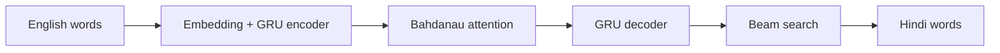

# translator.nlp

An English to Hindi neural machine translator built from scratch: a GRU encoder–decoder with Bahdanau attention, trained on 500,000 sentence pairs from the IIT Bombay English–Hindi corpus, served by a small FastAPI app that shows the attention map for every translation.

> **Live demo**: https://translator-nlp.onrender.com (free hosting: the first visit after a quiet spell can take up to a minute to wake up)

| | This model | Pretrained baseline ([opus-mt-en-hi](https://huggingface.co/Helsinki-NLP/opus-mt-en-hi)) |
|---|---|---|
| Test BLEU | **6.70** | 10.92 |
| Test chrF | **23.18** | 32.85 |
| Parameters | 24.2M | 76.4M |
| Training data | 500k pairs (IITB) | the much larger OPUS collection |

Both scored on the same 1,675 sentences of the official IITB test set. Details in [Results](#results).

## What I built and why

The architecture follows the classic Bahdanau et al. (2015) design. The parts below are where the work went beyond it.

- **Serving without TensorFlow.** TensorFlow alone needs more memory than a free 512 MB hosting instance has. [inference.py](inference.py) re-implements the encoder, attention, GRU cells and beam search in about 140 lines of NumPy, reading weights exported by [export_numpy.py](export_numpy.py). It reproduces the TensorFlow model's test BLEU exactly (6.70), and the server image installs only FastAPI, Uvicorn and NumPy.
- **Beam search with length normalisation.** Batched beam search (beam 5, score divided by length<sup>0.6</sup>, immediate repeats blocked) raised test BLEU from 4.29 with greedy decoding to 6.70. Without length normalisation, beam search favours short, truncated outputs.
- **Clean evaluation.** The corpus is heavily duplicated, so pairs are de-duplicated before sampling, and every sentence that appears in the validation or test set is removed from training. BLEU and chrF are computed with sacreBLEU on the official test split, which is only scored once, after training.
- **Early stopping on validation BLEU, not loss.** Training loss kept falling while translation quality peaked. Training stops after three epochs without a better validation BLEU and keeps the best weights (epoch 8 of 11).
- **Correct masking.** Padding is masked in both the encoder GRU and the attention scores, so the encoder state is taken at the last real word and no attention goes to padding.
- **An attention map that is honest about repeats.** The heatmap indexes rows and columns by word position, not by word. An earlier version keyed them by word, which merged repeated words like "the … the" into one row and showed wrong weights.
- **Resumable training on Windows.** Checkpoints are written every epoch, with retries because antivirus software briefly locks the files TensorFlow renames. An interrupted run loses at most one epoch.

## Results

[compare_models.py](compare_models.py) runs this model and Helsinki-NLP's pretrained `opus-mt-en-hi` (a Marian Transformer) on the same test sentences. Both outputs go through the same cleaning as the references (lowercase, punctuation split off, Devanagari only) before scoring. Every translation is saved in [data/comparison.json](data/comparison.json).

| Source length | Sentences | This model (BLEU) | Baseline (BLEU) |
|---|---|---|---|
| 3–10 words | 404 | 8.48 | 11.66 |
| 11–20 words | 1,032 | 6.79 | 11.17 |
| 21–30 words | 239 | 5.11 | 9.58 |
| **All** | **1,675** | **6.70** | **10.92** |

This model reaches about 60% of the baseline's BLEU and 70% of its chrF, with a third of the parameters and a small fraction of the training data. Both scores are low in absolute terms. The IITB test set is news text with loose references: for *"When the service was delayed, he started shouting abuse…"* the reference begins *खाना बनने में देरी हुई* ("when the food was delayed"). The baseline also often ends sentences with "." where the references use "।", which costs it a little.

## Error analysis

Measured over all 1,675 test translations:

| Problem | How often | Cause |
|---|---|---|
| Output contains `<unk>` | 64% | Word-level vocabulary capped at 30,000 words, so names and rare words have no token |
| A two-word phrase repeats | 30% | The decoder loses track of what it has already written (see below) |
| Under 60% of the reference's length | 26% | The decoder ends the sentence early or drops clauses |
| Quality falls with length | BLEU 8.5 → 5.1 | Short sentences survive the weak decoder memory; long ones don't |

Examples (lowercased by the cleaning step):

| English | This model | Problem |
|---|---|---|
| Police estimate that hundreds of people had been defrauded by the gang. | पुलिस का अनुमान लगाया कि सैकड़ों लोग `<unk>` से `<unk>` रहे हैं । | "defrauded" and "gang" are outside the vocabulary |
| Passengers often grumble about baggage charges and other fees, but airlines love them. | यात्रियों के सामान और अन्य फीस के बारे में प्रायः `<unk>` शुल्क और अन्य फीस के बारे में प्रायः `<unk>` शुल्क … | Loops until the length limit |
| And while Congress can't agree on whether to proceed, several states are not waiting. | और कांग्रेस के बारे में सहमत नहीं , | Stops after the first clause |
| One in 20 children in the United States now have food allergies. | संयुक्त राज्य अमेरिका में एक बच्चे हैं । | Fluent, but drops "20" and "food allergies" |
| This is a good book. | यह एक अच्छा किताब है । | Gender agreement: किताब is feminine, so it should be अच्छी |
| hi how are you | हाय , | Casual chat is almost absent from the corpus |

The baseline shares some of these failures. It has no `<unk>` because it uses subwords, but it spells unfamiliar names phonetically and sometimes wrongly ("Halloween" → महिमावानेन).

### What would fix them

1. **Subword vocabulary** (BPE or SentencePiece). It removes `<unk>` entirely and lets the model copy names. This is probably the largest single gain.
2. **Give the decoder its memory back.** As in the TensorFlow tutorial this model is based on, the decoder GRU starts from a zero state at every step ([inference.py](inference.py) notes it), so the previous state only reaches it through the attention query. Passing the state through properly should reduce looping and dropped clauses.
3. **A Transformer** trained on the same data, for a direct comparison of the two architectures.
4. **Conversational data** (for example subtitle corpora) mixed into training, for greetings and everyday speech.

## Architecture



Embeddings and GRUs are 256-dimensional, with dropout 0.3, sentences up to 30 words, and a 30,000-word vocabulary on each side.

## Tech stack

- **Training**: TensorFlow / Keras, Hugging Face Datasets, sacreBLEU
- **Serving**: NumPy, FastAPI, Uvicorn, Docker (deployed on Render)
- **Frontend**: plain HTML/CSS/JS, D3.js (attention map), Chart.js (training curves)
- **Baseline comparison**: PyTorch, Hugging Face Transformers

## Running it

1. **Clone the repository**:
   ```bash
   git clone https://github.com/sarvesh-raam/translator.nlp.git
   cd translator.nlp
   ```

2. **Install dependencies** (inside a virtual environment):
   ```bash
   python -m venv .venv
   .venv\Scripts\activate   # Windows; use `source .venv/bin/activate` on macOS/Linux
   pip install -r requirements.txt
   ```

3. **Run the app** with the trained weights included in the repo:
   ```bash
   python main.py
   ```
   Then open `http://127.0.0.1:8000`.

4. **Retrain from scratch** (optional; downloads the corpus):
   ```bash
   python preprocess.py
   python train.py
   python export_numpy.py
   ```

5. **Reproduce the comparison** (optional):
   ```bash
   pip install torch transformers sentencepiece
   python compare_models.py
   ```

## License

Distributed under the MIT License. See `LICENSE` for more information.
